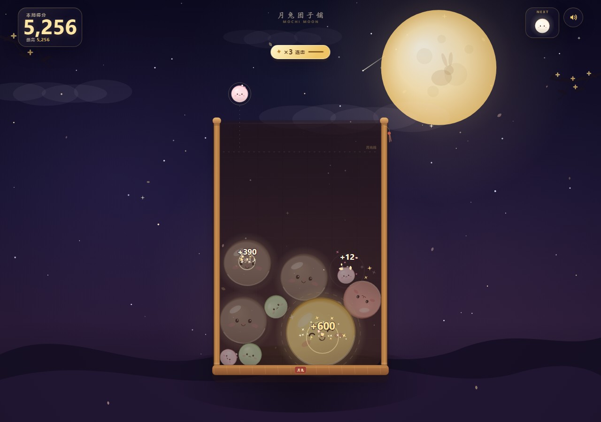

# 月兔团子铺 · Mochi Moon

一个月夜主题的**物理掉落合成**小游戏。把糯米团投进竹笼，两颗相同的团子相撞就会合体升级；一路从糯米团合成到满月团，看看你能守住月光线多久。

**在线试玩：** <https://aduoer.github.io/mochi-moon/>



<details>
<summary>看看开始界面</summary>


</details>

  

## 怎么玩

| 操作 | 说明 |
| --- | --- |
| 移动鼠标 / 拖动手指 | 左右瞄准 |
| 点击 / 松开手指 | 投放团子 |
| `A` `D` 或 `←` `→` | 键盘瞄准 |
| `空格` | 投放 / 开始下一局 |

- 两颗**同级**团子碰在一起会合成更高一级的团子，并获得分数。
- 同一次投放引发的**连锁合成**会累积连击倍率，最高 ×5；下一次投放会重新开始计算。
- 当团子堆越过上方的金色**月光虚线**并保持一段时间，本局结束。
- 两颗**满月团**相撞会触发「满月当空」，清空附近团子并得到大额奖励。

进化链：糯米团 → 樱花团 → 抹茶团 → 桂花团 → 红豆团 → 芝麻团 → 月兔团 → 金月团 → 满月团。

## 本地运行

项目是纯静态页面，不需要安装或构建。用任意静态服务器打开即可：

```bash
cd mochi-moon
python -m http.server 4173
# 浏览器访问 http://127.0.0.1:4173/
```

不要直接双击 `index.html`，因为游戏使用 ES modules，`file://` 协议下会被浏览器拦截。

## 项目结构

```text
mochi-moon/
├── index.html            # 页面结构与 UI
├── favicon.svg
├── LICENSE
├── css/
│   ├── base.css          # 游戏画布、HUD、基础样式
│   └── overlays.css      # 开始 / 结算卡片与响应式布局
├── js/
│   ├── config.js         # 九级团子、掉落权重、计分档位
│   ├── utils.js          # 通用工具函数
│   ├── audio.js          # Web Audio 合成音效
│   ├── background.js     # 月夜星空背景
│   ├── mochi-art.js      # Canvas 团子绘制
│   ├── particles.js      # 粒子与合成特效
│   ├── stage.js          # 场景缩放、竹笼与 Canvas 渲染
│   └── game.js           # 物理、合成、输入、计分与主循环
├── docs/                 # README 截图
└── vendor/
    └── matter.min.js     # Matter.js 0.20.0（MIT）
```

## 技术说明

- **渲染**：原生 Canvas 2D，固定 560 × 880 世界坐标，自适应缩放至不同屏幕。
- **物理**：Matter.js 的圆形刚体、静态竹笼边界与 `collisionStart` 合并检测。
- **声音**：Web Audio 实时合成，不包含任何音频资源文件；可静音，并记住偏好。
- **存储**：`localStorage` 保存历史最高分与声音开关。
- **无障碍**：开始 / 结算弹窗、键盘可玩、声音按钮带 `aria-pressed`、结果通过 live region 播报。
- **调试**：访问 `?debug=1` 后，浏览器控制台可用的只读/调试接口挂在 `window.__mochiDebug`。

## 设计与版权说明

- 玩法灵感来自广受欢迎的「水果掉落合成 / Suika」类型，代码、视觉、角色和文案均为本项目原创实现。
- 本项目与任何官方 Suika / 合成大西瓜作品无关联，也未使用其美术或音频素材。
- 物理引擎为 [Matter.js](https://brm.io/matter-js/)，遵循 MIT 许可；许可证全文见 `vendor/MATTER-LICENSE.txt`。
- 本项目代码以 MIT 许可发布，详见 `LICENSE`。

---

做一颗圆滚滚的团子，等一轮慢慢变满的月亮。
